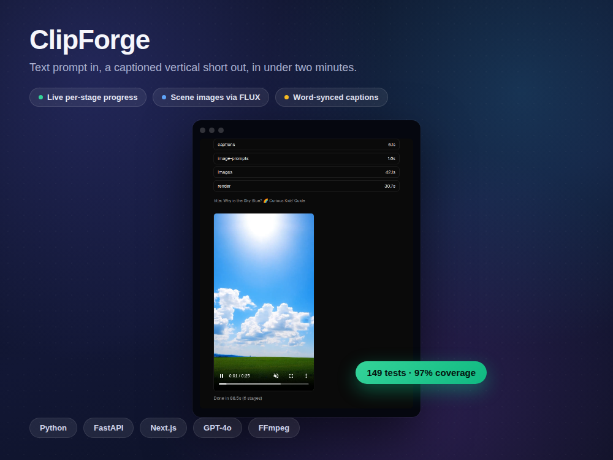

# ClipForge

Prompt-driven YouTube Shorts pipeline: text prompt → GPT-4o script → TTS voiceover → Whisper-timed captions → GPT-4o scene prompts → Replicate FLUX images → ffmpeg-rendered vertical video with burned-in captions.

## Demo

[](docs/demo/demo.mp4)

A real run, narrated: a text prompt goes in, live per-stage progress streams over SSE (script, voiceover, captions, scene images, render), and a captioned vertical short comes out in under two minutes. [Watch the recording](docs/demo/demo.mp4).

## Setup

```bash
cp .env.example .env   # fill in API keys
python3 -m venv .venv && .venv/bin/pip install -r requirements.txt
```

Machine-level dependency: `ffmpeg` with the `drawtext` filter (verify: `ffmpeg -h filter=drawtext`). Running via Docker avoids this entirely.

## Docker (recommended)

The image carries Python deps (Streamlit included) + ffmpeg (with drawtext
asserted at build time); no host installs needed. Three entrypoint modes:

```bash
docker build -t clipforge .
docker run --rm clipforge        # test    - run the test suite (default CMD)
docker run --rm ... clipforge run <cli args>   # run     - the CLI pipeline
docker run --rm -p 8501:8501 ... clipforge ui  # ui      - the Streamlit front-end
```

Secrets stay on the host: `.env` is passed with `--env-file` at runtime and is excluded from the image by `.dockerignore`.

## Full pipeline

```bash
python -m clipforge "Why the sky is blue, for curious kids"   # render + schedule upload +24h
python -m clipforge "..." --no-upload                          # render only
python -m clipforge "..." --publish-now                        # publish immediately, not scheduled
```

Run artifacts land in `./runs/run-<timestamp>/`: script.json, voiceover.mp3, captions.json (+.srt), images/, short.mp4, publish.json.

Via Docker:

```bash
docker run --rm --env-file .env -v "$PWD/runs:/app/runs" clipforge \
    run "Why the sky is blue, for curious kids" --no-upload
```

## Web UI

Same pipeline behind a browser page, with a live timing row per stage and the
total elapsed time at the end:

```bash
.venv/bin/streamlit run clipforge/ui.py
```

Controls: prompt box, scene-image count, target length, and a
"Also schedule on YouTube" checkbox (off by default — uploads only happen when
explicitly ticked). The finished short plays in the page; run artifacts land in
the same `runs/run-<timestamp>/` layout as the CLI.

Via Docker — UI at http://localhost:8501:

```bash
docker run --rm -p 8501:8501 --env-file .env \
    -v "$PWD/runs:/app/runs" clipforge ui
```

To let the upload checkbox work, mount the cached OAuth token too (consent
first via the CLI, since the container has no browser):

```bash
docker run --rm -p 8501:8501 --env-file .env \
    -v "$PWD/runs:/app/runs" \
    -v "$PWD/.clipforge_youtube_token.json:/app/.clipforge_youtube_token.json" \
    clipforge ui
```

## Frontend (Next.js)

A Next.js app in `frontend/` is the split-architecture replacement for the
Streamlit UI above: same prompt-in/video-out flow, BYO-keys demo mode, and
live per-stage progress, but talking to the FastAPI backend (`clipforge/api.py`)
over REST + SSE instead of running the pipeline in-process.

```bash
cd frontend
cp .env.local.example .env.local   # set NEXT_PUBLIC_API_URL to the backend's URL
npm install
npm run dev                         # http://localhost:3000
```

The backend defaults to `http://localhost:8080` — run it locally with
`docker run --rm -p 8080:8080 --env-file .env clipforge api` or
`uvicorn clipforge.api:app --port 8080` from the repo root.

```bash
cd frontend
npm run lint    # eslint
npm run build   # production build
npm test        # vitest - covers the SSE event reducer and stream parsing
```

## Tests

One gate runs lint, format and the whole suite (149 tests) under a 95%
coverage floor:

```bash
.venv/bin/python scripts/test.sh   # local venv
docker run --rm clipforge          # same gate inside the container
```

Layers: unit tests per stage module (fakes, no API cost), integration tests
for the full pipeline orchestration, AppTest browser tests driving the
Streamlit UI in-process, an opt-in Playwright tier that boots the real app in
a real browser (`sh scripts/browser_test.sh`), and the container gate for env
parity. See [AGENTS.md](AGENTS.md) for the testing conventions and the
test-first workflow every change follows.

## Deployment (on demand, not kept running)

ClipForge is built to deploy to AWS from GitHub Actions and is brought up only when needed, so there is no
public live link. Infrastructure is one Terraform setup in `infra/`:

- `infra/modules/ec2_api`: the FastAPI backend on an EC2 instance with Caddy in front (Caddy gets its own
  Let's Encrypt certificate; no managed proxy sits in the request path, which keeps the multi-minute SSE
  progress stream alive)
- `infra/modules/frontend`: the static-exported Next.js frontend on S3 and CloudFront
- `infra/modules/service`: the Streamlit BYO-keys demo on AWS App Runner
- `infra/modules/quota`: the S3 counter behind the demo's daily run cap
- DNS records on Cloudflare, created and removed in the same apply

Two manual, approval-gated workflows run it: `demo-up` (build the image, push to ECR, apply Terraform,
smoke-test) and `demo-down` (destroy everything). CI checks the LocalStack-supported parts on every change,
plus `terraform validate` and `fmt`:

```bash
sh scripts/infra_localstack.sh   # LocalStack gate (fmt + validate + apply quota)
sh scripts/infra_plan_real.sh    # read-only real `terraform plan` against your own AWS account
```

The real-plan script needs your own AWS profile and Cloudflare token (see the comments at its top).
Visitors to a running demo bring their own API keys, no operator secrets are deployed, and YouTube
publishing is excluded from the demo path.
